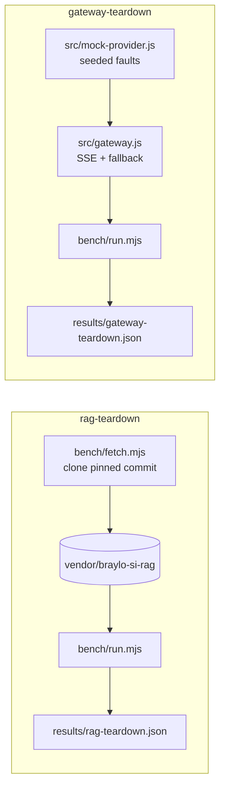

# genai-teardowns

Public deep-dive teardowns of GenAI systems, each with a system diagram, cost-per-task math and a reproducible local benchmark. Every number is read from a committed result file; anything that needs a paid or quota-limited API is marked **not run**.

| # | Teardown | Subject | Benchmark |
|---|---|---|---|
| A | [RAG system](rag-teardown/README.md) | [braylo-si-rag](https://github.com/braylo777/braylo-si-rag) @ `a1403da`: hybrid BM25 + vector RAG agent with tools and guards on Cloudflare Workers | repo's own tests/evals re-run, top-k recall vs tokens vs cost sweep, pipeline latency |
| B | [Agent gateway](gateway-teardown/README.md) | SSE streaming gateway with fallback routing (built here) | 6 fault scenarios × 200 requests against seeded mock providers |
| C | EAS benchmark | [braylo-ai/eas-benchmark](https://github.com/braylo-ai/eas-benchmark) | separate repo |

## Why
Most write-ups about RAG and gateways show the happy path. A teardown should show where latency and money actually go, which failure modes hurt users, and which numbers are measured versus assumed.

## Architecture (what this repo contains)


## Headline results
- **RAG:** the no-model pipeline runs in p50 0.22 ms; the LLM call is the entire cost. Raising top-k from 5 to 10 lifts recall@k 0.81 → 0.90 for +36% cost per one-call task (estimated). The two-call tool path doubles cost because it re-sends all sources. The lexical scope guard wrongly refuses 4/24 on-topic eval questions.
- **Gateway:** overhead is below noise on localhost; a stalled provider pushes p95 TTFT to 1552 ms (the TTFT timeout); on mid-stream drops, `resume` keeps 200/200 answers versus 155/200 with `error`.

## Run it
```bash
npm test             # 14 tests (gateway routing, SSE parsing, cost/percentile helpers)
npm run rag:fetch    # clones braylo-si-rag at the pinned commit into vendor/ (gitignored)
npm run rag:bench    # writes results/rag-teardown.json
npm run gw:bench     # writes results/gateway-teardown.json (~2 min)
```
Node 20+; no dependencies.

## Limits
- Token counts in teardown A are chars/4 estimates; output lengths are assumptions. Vector/hybrid retrieval and LLM answer quality were not measured.
- Teardown B uses mock providers on localhost and illustrative prices.

## License
MIT
