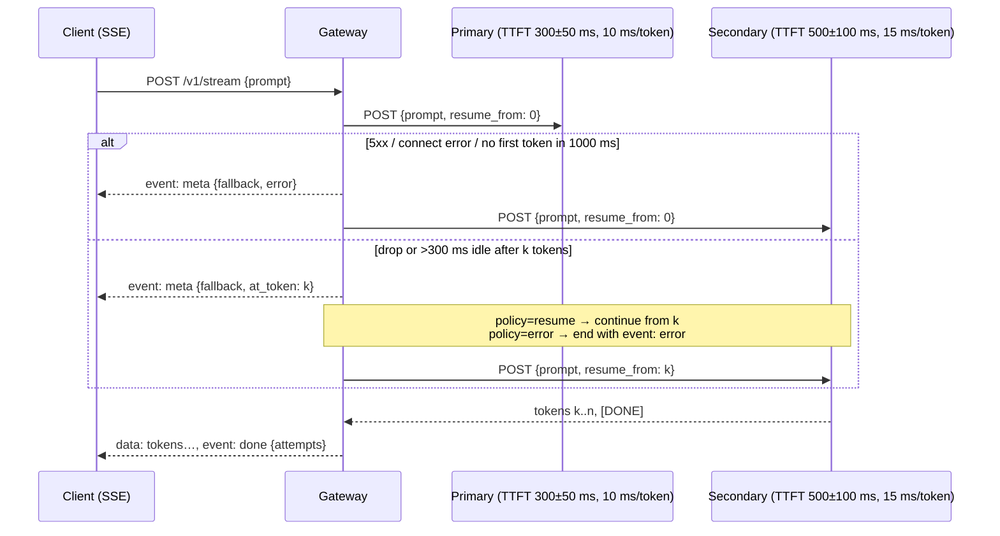

# Teardown B — agent gateway: SSE streaming + fallback routing

A small, self-contained gateway ([`src/gateway.js`](src/gateway.js), ~120 lines, no dependencies) that streams tokens to the client over SSE and routes across two upstream providers. The benchmark runs two **mock** providers on localhost with seeded fault injection, so every number is reproducible with `npm run gw:bench`. Results: [`../results/gateway-teardown.json`](../results/gateway-teardown.json) (Apple M2 Pro, Node v24.15.0, 200 requests per scenario, concurrency 10, 40-token answers).

## System diagram

## How it works
- **Two timeouts, not one.** `ttftTimeoutMs` (1000 ms) bounds the wait for the first token; `idleTimeoutMs` (300 ms) bounds the gap between tokens. A single overall timeout cannot tell a slow-but-healthy stream from a hung one.
- **Fallback before the first token is free for the user**: nothing was shown yet, so the gateway silently switches.
- **Fallback after the first token needs a policy.** `error` ends the stream (the user sees a partial answer). `resume` asks the next provider to continue from the last delivered token index; the gateway only forwards token `i` if `i` equals the next expected index, so there are no duplicates. With real LLMs "resume" means a continuation prompt, which the second model may not continue faithfully; the mock providers return the same deterministic text, so this benchmark measures the **mechanics**, not continuation quality.
- **Every upstream token is billed**, including tokens from failed attempts. The benchmark counts tokens sent by each provider.

## Results (MOCK providers, seeded faults; prices ILLUSTRATIVE: primary $10, secondary $2 per 1M output tokens)
| Scenario | Success | TTFT p50 / p95 (ms) | Total p50 / p95 (ms) | Tokens billed per success | Illustrative $ per 1k tasks |
|---|---|---|---|---|---|
| Direct to primary (no gateway) | 1.000 | 306.3 / 348.5 | 733.8 / 781.6 | 40.0 | 0.400 |
| Gateway, healthy | 1.000 | 304.0 / 345.8 | 733.0 / 777.6 | 40.0 | 0.400 |
| Primary 503 on 45/200 | 1.000 | 311.8 / 552.5 | 730.4 / 1174.6 | 40.0 | 0.328 |
| Primary stalls on 45/200 | 1.000 | 314.2 / **1552.4** | 741.0 / 2175.2 | 40.0 | 0.328 |
| Primary drops mid-stream on 45/200, policy `error` | **0.775** | 306.6 / 370.9 | 741.8 / 816.0 | 45.8 | 0.458 |
| Primary drops mid-stream on 45/200, policy `resume` | 1.000 | 304.3 / 344.7 | 741.7 / 1377.0 | 40.0 | 0.364 |

Fault rate was configured at 20%; the seeded RNG produced 45/200 (22.5%) faulted requests in each fault scenario. Success means the client received exactly the expected 40 tokens and a `done` event.

Reading:
- **Gateway overhead is below measurement noise** here (TTFT p50 304.0 ms via gateway vs 306.3 ms direct; localhost, so network cost is excluded).
- **503s are cheap to absorb**: p95 TTFT rises by ~200 ms (the secondary's slower TTFT), success stays 100%.
- **Stalls are the expensive failure**: p95 TTFT jumps to 1552 ms because the gateway must wait the full 1000 ms TTFT timeout before failing over. The TTFT timeout is the user-visible cost of a hung provider; tune it near the provider's real p99 TTFT, or hedge (fire the secondary after p95 TTFT) at the price of duplicate tokens.
- **Mid-stream drops are where policy matters**: `error` loses 22.5% of answers and still bills the wasted half-streams (45.8 tokens per success); `resume` keeps 100% success at 40 tokens per success, adding ~600 ms to p95 total.
- Under this illustrative price pair, fallback to a cheaper secondary *lowers* cost per task; with a pricier backup the sign flips. The useful number is tokens billed per success, which is price-independent.

## Limits
- Mock providers on localhost: no real network, TLS, provider rate limits or tokenizer differences.
- `resume` assumes the backup can continue from an index; real models need a continuation prompt and may change style mid-answer.
- No hedged requests, retries with backoff, or circuit breaker in this gateway (see the sibling `webgpu-edge-fallback` repo for a breaker); single process, no auth.
