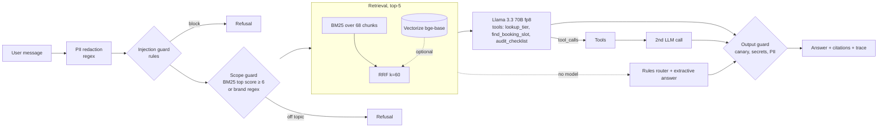

# Teardown A — braylo-si-rag (hybrid RAG agent on Cloudflare Workers)

Subject: [github.com/braylo777/braylo-si-rag](https://github.com/braylo777/braylo-si-rag) pinned at commit `a1403da` (2026-10-27).
Every number here comes from [`../results/rag-teardown.json`](../results/rag-teardown.json), produced by `npm run rag:fetch && npm run rag:bench` on an Apple M2 Pro, Node v24.15.0. No model was called.

## System diagram

## Request path and where the cost goes
1. **Guards (≈0.01 ms each).** Regex PII redaction and rule-based injection guard run before anything is logged or sent to a model.
2. **Scope guard (p50 0.08 ms).** Lexical: on-topic if the best BM25 score ≥ 6 *or* a brand regex matches.
3. **Retrieval (p50 0.08 ms for BM25).** Top-5 chunks are fused by RRF when Vectorize is present, else BM25 only.
4. **LLM.** One call, or two when the model asks for a tool. Each call re-sends the system prompt and all five sources.

The whole no-model path (guards → retrieval → extractive answer → output guard) measured **p50 0.22 ms, p95 0.36 ms, p99 0.44 ms** over 720 runs. On this design, local compute is noise; the LLM call is the whole latency and cost budget.

## Reproduced results (the repo's own tests and evals)
| Check | Value |
|---|---|
| Repo test suite | 24/24 pass |
| BM25 recall@5 (all 24 / test 12) | 0.81 / 0.771 |
| BM25 MRR (all / test) | 0.726 / 0.605 |
| Scope guard, test split | 0.842 accuracy; 7/7 off-topic blocked; **3/12 on-topic wrongly blocked** |
| Injection guard | 29/30 attacks blocked, 0/10 benign FP (tuned on that set: optimistic) |
| Extractive fallback, answer contains gold phrase | 0.417 |
| On-topic eval queries refused by the scope guard (no-model path) | 4/24 (r11, r16, r22, r23) |

These match the numbers in that repo's README, so the published eval is reproducible from a clean clone.

## Context size vs recall vs cost (top-k sweep)
Prompt tokens = system prompt + k sources + question, counted with the repo's own `estTokens` (chars/4, **an estimate**, not a Llama tokenizer). Cost uses the repo's neuron price table for `@cf/meta/llama-3.3-70b-instruct-fp8-fast` (read from Cloudflare's pricing page on 2026-10-27; free tier pays $0). Output lengths are **assumptions**.

| top-k | recall@k (all) | recall@k (test) | prompt tokens mean / p95 | $ per task, 1 call, 150 out | $ per task, tool path (2 calls) |
|---|---|---|---|---|---|
| 1 | 0.357 | 0.306 | 270 / 346 | 0.00042 | 0.00092 |
| 3 | 0.645 | 0.500 | 566 / 677 | 0.00050 | 0.00110 |
| **5 (shipped)** | **0.810** | **0.771** | **845 / 1000** | **0.00059** | **0.00126** |
| 8 | 0.854 | 0.792 | 1292 / 1482 | 0.00072 | 0.00152 |
| 10 | 0.903 | 0.875 | 1573 / 1780 | 0.00080 | 0.00169 |

Reading:
- On this model the price is output-heavy (≈205k neurons per M output tokens vs ≈27k per M input), so going from k=5 to k=10 adds +36% cost per one-call task while recall@k rises 0.81 → 0.90. That is cheap recall; for a sales assistant where a wrong price is costly, k=8–10 is defensible.
- The **tool path doubles cost**, because the second call re-sends the full prompt. 20.8% of the eval queries route to a tool by the rules router. Shrinking the second call (send tool results + question, not all five sources again) is the biggest cost lever in the design.
- At ~$0.0006 per answer, 1,000 chats per month cost ≈ $0.59 at list price, before free-tier allowance.

## Failure modes found
1. **Lexical scope guard is the main quality bottleneck.** It refuses 4/24 genuine questions before retrieval runs. A small embedding-similarity check against the KB (already in Vectorize) would replace a hand-set BM25 threshold.
2. **Extractive fallback is weak (0.417 gold-phrase rate).** When Workers AI is out of quota, users get noticeably worse answers. The fallback should prefer the tool result or a "book a call" CTA over a low-overlap sentence.
3. **Injection-guard numbers are in-sample.** 29/30 is on the set the rules were written against; an independent red-team set is still needed.
4. **Vector and hybrid retrieval were never measured** (the source repo marks them "not yet run"); the RRF gain over BM25 is unknown.

## Not run here
Vector/hybrid retrieval metrics, LLM answer quality, real token usage from the API, and edge latency on Cloudflare — all need Workers AI calls. Nothing in this teardown claims them.
